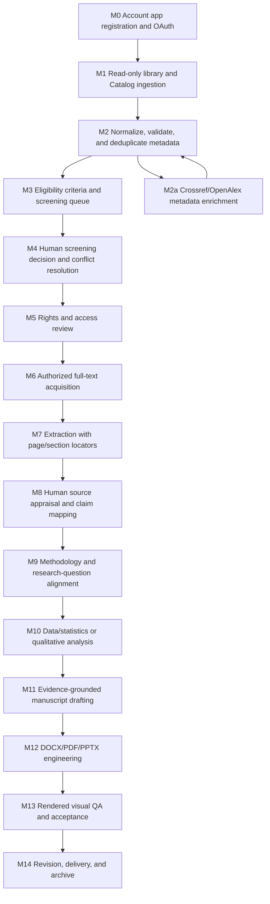

# Mendeley-to-Thesis Automation Roadmap

**Status:** engineering roadmap for the Mendeley connector candidate on `feature/mendeley-api-integration`. This document does not authorize a research phase, approve a thesis, or assert that a live Mendeley account has been connected.

## 1. Objective and boundaries

The intended workflow is to turn an explicitly authorized Mendeley library into a traceable, reviewable source pipeline for a private Project-SKRIPSI workspace. Mendeley is a reference-management and metadata source, not an evidence-verification authority. A library record, abstract, attached PDF, DOI, or Catalog result is not by itself proof that a thesis claim is supported.

The implementation remains local-first and free-first:

- Use the Mendeley Developer REST API and Python standard library. No paid SDK or paid runtime service is required by the current connector.
- Use existing Crossref/OpenAlex adapters for public metadata enrichment where appropriate; preserve provider-specific provenance.
- Keep PDFs, raw exports, credentials, participant data, and record-level thesis data in private workspaces. Never place them in this public source repository.
- Preserve copyright, license, subscription, institutional-access, and provider API restrictions. Never scrape or bypass access control.
- Never fabricate bibliographic metadata, locators, research data, analytical results, approvals, reviewer identities, or author contributions.
- Treat every new stage as a separate stateful workflow with explicit input validation, idempotency, retry policy, audit evidence, and human approval gates.

Mendeley OAuth uses the documented `scope=all` authorization-code flow. It is broad resource access, including private-library write operations. The connector warns before consent; the user must decide whether the requested access is acceptable. Provider terms also restrict multiple applications for one use case and API use that competes with Mendeley. Do not release a commercial or multi-client Mendeley-backed service unless the intended use has been checked with the provider and the necessary permission has been obtained.

## 2. Stage map and dependency graph

M0–M2 establish the source-control foundation. Later stages depend on verified predecessors. A failed or incomplete stage must not be silently marked complete to allow downstream work to proceed.

## 3. Stage contracts

| Stage | Inputs | Automation | Required output and gate |
|---|---|---|---|
| **M0 — Account authorization** | Developer app ID/secret, registered redirect URI, user consent | OAuth Authorization Code, one-use state, local token storage/rotation, connection diagnostics | Live `profile` read succeeds. Secrets stay local. User confirms requested `scope=all`. |
| **M1 — Read-only ingestion** | Authorized account, library documents, selected Catalog queries | Paginated GET, bounded retry, API media types, raw response provenance, export/preview | Immutable ingestion snapshot plus source candidates. No delete, update, upload, group invitation, or workspace write. |
| **M2 — Normalize and deduplicate** | M1 candidates; optional Crossref/OpenAlex results | Canonical title/author/year/DOI normalization; stable IDs; exact DOI/identifier matching; fuzzy title/year candidate matching; conflict reporting | Validated candidate records and duplicate/conflict report. Never merge records solely because fuzzy scores are high. |
| **M3 — Criteria and screening queue** | Normalized candidates; approved protocol | Apply explicit inclusion/exclusion fields to generate a triage queue; show reasons and missing metadata | Screening queue with deterministic rule version. Machine suggestions are recommendations, not final inclusion decisions. |
| **M4 — Human screening** | Title, abstract, metadata, approved criteria | Present independent reviewer decisions, conflict detection, adjudication queue, PRISMA-style counts | Human-recorded include/exclude/uncertain decision and reason. Do not invent a second reviewer or simulate agreement. |
| **M5 — Rights/access review** | Included source, source link, attached-file metadata, institutional context | Detect available file metadata and known license declarations; prepare rights checklist | Explicit `rights_status` evidence. Unknown rights remain unknown. A PDF being downloadable does not prove permission to redistribute or quote. |
| **M6 — Authorized full-text acquisition** | Human-approved item and rights/access decision | Prefer Mendeley attachment download or institutionally authorized access; verify file type/size/hash; quarantine suspicious files | Private immutable file snapshot and SHA-256. If authorization is unclear, keep metadata-only and stop. |
| **M7 — Structured extraction** | Verified PDF or HTML | Extract title, authors, abstract, sections, tables, references, page labels, and candidate passages with local tools | Extraction artifact with parser/version/hash and exact page/section locators. OCR is a last resort and must be flagged. |
| **M8 — Appraisal and evidence mapping** | Extracted content, study design, source register | Build quality/appraisal checklist, identify limitations, populate candidate claim-to-source mappings | Human-reviewed appraisal and claim locators. Metadata-only sources cannot become evidence links. |
| **M9 — Methodology alignment** | Approved research questions/objectives, design, constructs, methods, corpus | Check alignment among question, objective, method, sample, instrument, analysis, and evidence | Structured alignment findings; errors block readiness, warnings/review items remain visible. No automatic research design approval. |
| **M10 — Analysis** | Authorized datasets, codebook, analysis specification | Reproducible quantitative and qualitative workflows; validation, assumptions, diagnostic reports, scripts and environment details | Reproducible output with input/output hashes, methods and interpretation constraints. Never generate missing observations or fabricate findings. |
| **M11 — Manuscript drafting** | Human-authored thesis logic, accepted evidence map, analysis outputs, citation style | Assist with section scaffolding, citation formatting, editing, cross-reference checks, and consistency | Draft with source-to-claim traceability and authorship disclosures. Do not invent citations, data, or conclusions. |
| **M12 — Document engineering** | Approved manuscript, institutional template, citation style, visual assets | OOXML section/page setup, page numbering, headers/footers, tables, references, figures, diagrams, PPTX and Morph-ready slide construction | DOCX/PDF/PPTX artifacts plus machine-readable layout specification. Preserve original structure when revising client documents. |
| **M13 — Rendered QA** | Output DOCX/PDF/PPTX and visual specification | LibreOffice/PDF rendering; page-by-page visual comparison; overflow, orphan/widow, broken references, figure/table, typography, and page-number checks | QA report with page/image evidence and severity. A passing parser/schema check is not a visual pass. |
| **M14 — Revision and delivery** | QA report, user/client feedback, approved final | Revision-pair tracking, checklist closure, delivery manifest, archive and checksum | Acceptance record, delivery artifact hashes, version history, unresolved issues. Only the user/client can grant acceptance. |

## 4. Data model and state transitions

The source pipeline should keep bibliographic identity, access rights, content review, screening, and evidence status as distinct dimensions. Do not overload one boolean such as `verified=true`.

Recommended future state dimensions:

- **Ingestion:** `DISCOVERED`, `NORMALIZED`, `DUPLICATE_CANDIDATE`, `INGESTION_REJECTED`.
- **Screening:** `NOT_SCREENED`, `SCREENING_PENDING`, `INCLUDED`, `EXCLUDED`, `UNCERTAIN`, `CONFLICT_PENDING`, `ADJUDICATED`.
- **Access/rights:** retain `METADATA_ONLY` when content has not been reviewed; retain `UNKNOWN` rights when no explicit evidence exists; record the basis and date for any later decision.
- **Content review:** `NOT_REVIEWED`, `EXTRACTION_PENDING`, `EXTRACTED_UNVERIFIED`, `HUMAN_REVIEWED`.
- **Evidence mapping:** `NO_CLAIM_LINK`, `CLAIM_LINK_CANDIDATE`, `HUMAN_APPROVED_LINK`, `LINK_REJECTED`.

These are design targets, not assertions that the current source-register schema already accepts every value. Before implementation, add versioned schema migrations, validators, migration fixtures, and backward-compatible readers. Preserve existing status enums until the schema change is reviewed and tested.

Every transition should persist:

- source/workspace ID and the exact source record ID;
- transition name and previous/next state;
- actor type (system suggestion, authenticated user, or named human reviewer from verified account data);
- protocol/rule version and timestamp;
- input/output SHA-256 values or stable source references;
- rationale, evidence locators, warnings, and approval state;
- deterministic idempotency key for retriable writes.

Do not put OAuth secrets, access/refresh tokens, private file bytes, or personally identifying student/client content in audit summaries.

## 5. Cross-stage orchestration requirements

**Checkpointing and replay.** Each stage writes an immutable input snapshot and output manifest. Re-running a stage with the same input hash and configuration should return the same result or a documented cache hit. If the source, criteria, parser, prompt, model, analysis code, or template version changes, produce a new run ID and preserve the prior result.

**Failure policy.** Retry read-only network requests only within a bounded budget and honor provider `Retry-After`. Do not blindly retry a mutation after an ambiguous timeout. Reconcile remote state first. Local writes require atomic replacement, backup/journal, and recovery tests where practical.

**Approval boundaries.** Automatic operations may list, search, normalize, deduplicate, validate, and prepare candidate queues. Human authorization is required to connect an account, grant broad OAuth permission, mutate Mendeley records, apply workspace imports, include/exclude studies, assert rights, promote extracted text to reviewed evidence, accept analysis interpretation, approve manuscript claims, or accept final delivery.

**Observability.** Record run ID, stage ID, dependency IDs, status, start/end time, retry count, input/output hashes, warnings, errors, and approval checkpoints. Provide a CLI `status`/resume view before building a web dashboard. Keep private run logs and data in the workspace, not public repository CI logs.

**Free-first implementation.** Prefer Python standard library for glue and file operations, existing Crossref/OpenAlex adapters for metadata, locally available PDF/office tooling, R/Python open-source analysis, LibreOffice for rendering, and local schema/test utilities. Optional heavier tooling must be profile-based and installed only for desktop environments; do not make the mobile Termux runtime depend on PyTorch, OCR, browser automation, or large native libraries.

## 6. Delivery roadmap and acceptance gates

| Engineering ID | Engineering increment | Exit criteria |
|---|---|---|
| **E0** | Mendeley OAuth and read-only adapter | Real user consent succeeds; live profile and small library read succeed; no secret in repo/logs. |
| **E1** | Ingestion preview, source normalization, stable dedup | Unit/property tests; replay idempotency; conflicts surfaced; metadata-only preserved. |
| **E2** | Crossref/OpenAlex enrichment and identifier reconciliation | Provider provenance preserved; DOI mismatch and duplicate conflicts tested; no silent overwrite. |
| **E3** | Screening protocol and human decision queue | Versioned criteria, decision log, conflict state, PRISMA count reconciliation; no synthetic reviewer. |
| **E4** | Rights/access and private file acquisition | File checksum, size cap, path safety, rights evidence, unauthorized access blocked. |
| **E5** | Extraction and evidence locators | Page labels and locators validated against source; parser/version provenance; human-review transition. |
| **E6** | Methodology, quantitative and qualitative analysis | Reproducible tests and diagnostics; no fabricated data; assumptions and interpretation limits documented. |
| **E7** | Manuscript, citation and document engineering | Template/APA-style conformance, section breaks, page numbering, references, tables and figure layout. |
| **E8** | Rendered visual QA and presentation automation | DOCX/PDF page-image audits, PPTX rendering, Morph compatibility tests, no overflow or missing elements. |
| **E9** | Revision/delivery and production operations | Acceptance workflow, checksums, privacy boundary, backups, observability, recovery and rollback tests. |

This roadmap is an engineering plan only. It does not change the canonical P0–P9 research ledger or human acceptance/authorization state. Each increment must pass its engineering tests and the relevant human approval gate before dependent automation is enabled.

## 7. Current verified checkpoint

At the time of this document:

- Mendeley integration is still on the draft PR branch and is not merged to `main`.
- The connector implements OAuth Authorization Code, local token storage/refresh, profile v2, private library document operations, folders, annotations, files, public Catalog lookup, supported private Groups v2 routes, and preview-first metadata-only sync.
- A dedicated CPython 3.14 connector workflow and six-job Ubuntu/Windows Python 3.10–3.12 matrix have passed in prior runs. The latest post-scope-warning changes must be revalidated on the current PR head.
- No real Mendeley account has been authorized and no live profile/library response has been observed. Native Termux browser/loopback behavior remains untested.
- The current sync imports metadata only and does not create claim-evidence links. Live rights review, full-text access, screening, appraisal, and research acceptance remain separate stages.
